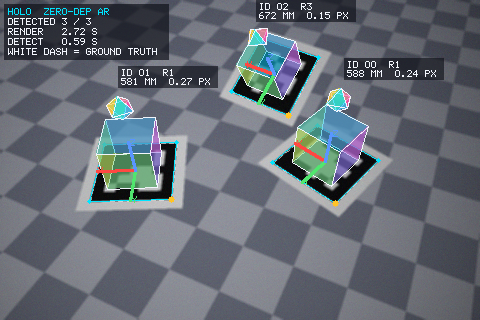
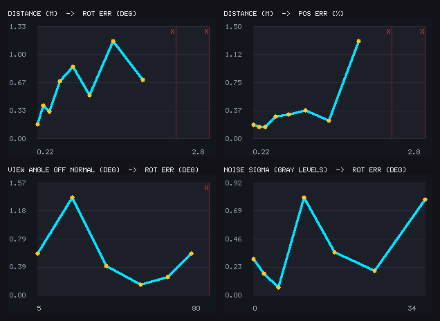
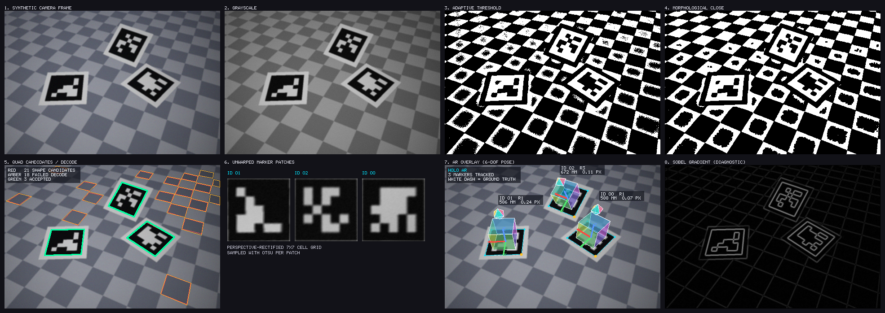

# Computer vision projects — three of them, built from the maths up

| | |
|---|---|
| **[CV FLOOR](#cv-floor--an-interactive-ar-floor-game-driven-by-pose-estimation)** | An interactive AR floor game. A camera watches a real floor, pose estimation finds everyone's feet, a homography maps them onto a virtual 8×8 tile grid, and you play by walking — including answering computer-science questions by standing on the right tile. |
| **[HOLO LAVA](#holo-lava--play-the-floor-is-lava-with-your-body)** | A webcam game. The floor is lava — step onto the safe tile, jump over the waves. Body detection written from scratch. |
| **[HOLO](#holo--an-augmented-reality-engine)** | An augmented reality engine in pure Python. Fiducial marker detection → 6-DoF camera pose → 3D objects anchored to the marker, plus the PNG and GIF codecs used to write the results. |

**On dependencies**, to be precise rather than flattering:

- **HOLO** and **HOLO LAVA** have *none*. No OpenCV, no NumPy, no Pillow, no
  TensorFlow, no game engine — every pixel is touched by code in this repo.
- **CV FLOOR** uses **MediaPipe** for pose estimation, and nothing else. Human
  pose estimation is a trained neural network; writing one from scratch is a
  different project from building a game on top of one. Everything *around* the
  model — calibration homography, floor-grid mapping, jitter filtering,
  multi-player identity, game rules, AR rendering — is written here and tested.

---

# CV FLOOR — an interactive AR floor game driven by pose estimation

**▶ [Play it here](https://dericsen.github.io/scratch-ar/floor/)** — point a
camera at a floor, click the four corners of the play area, and walk.

The camera image stays visible: real people on a real floor with the virtual
game drawn over them. Each player gets a circular marker under their feet that
lies flat on the ground, a stable player ID, a score, and a live readout of
which tile they are standing on (`PLAYER 1 · C4 · 120`).

## The pipeline

```
camera frame
  |
  v
pose estimation            MediaPipe PoseLandmarker, numPoses = 4
  |
  v
foot landmarks             heel + foot-index per foot, ankle as fallback
  |
  v
homography                 4 clicked floor corners -> unit square
  |
  v
floor coordinates          x, y in [0,1]
  |
  v
grid cell                  row A..H, column 1..8  ->  "C4"
  |
  v
player tracking            stable IDs, One Euro filter, tile hysteresis
  |
  v
game logic                 safe / dangerous tiles, CS questions, scoring
  |
  v
AR overlay                 tiles and markers drawn back through the homography
```

## The five decisions that make it work

**Feet, not bounding boxes.** A bounding-box centre sits near the chest and
swings whenever someone leans or raises an arm — it would report the wrong tile
constantly. The stance point is the midpoint of the heel and foot-index
landmarks, falling back to the ankle, and finally to the hips plus the lowest
visible landmark, with a confidence value attached so the caller knows which it
got. There is a test asserting the stance lands at the feet and is *more than
100 px away* from the hips.

**A homography, not a scaled grid.** Seen from an angle a square tile is a
trapezoid and far tiles are smaller, which no linear mapping can express. The
four corners you click are solved into a projective transform — an exact 8×8
linear system, since four point pairs give eight equations for eight unknowns.
Source coordinates are centred and scaled first: raw pixel values in the
thousands, squared in the projective terms, make the system ill-conditioned and
the grid visibly peels off the floor. The inverse direction is solved
independently from the same correspondences rather than by inverting the matrix,
which gives the tests a real consistency check (round-trip error < 1e-9).

**Jitter control, in two places.** Landmarks wobble a few pixels per frame even
when you stand perfectly still. Raw, that makes the detected tile flicker
between neighbours — scoring and killing players at random. First a One Euro
filter: an adaptive low-pass whose cutoff rises with measured speed, so a
standing player is filtered hard and a running one is barely filtered at all
(no rubber-banding). Then hysteresis on the tile decision itself, which only
commits to a new tile once the point is clearly inside it *or* has stayed there
several frames. Tested: 90 frames of 4 px landmark noise on a tile boundary
produce **zero** tile changes, while a deliberate step is accepted within three
frames.

**Global identity assignment.** Pose models return a list of people per frame
with no IDs attached, and the order can change between frames. Identities come
from matching detections to existing tracks by distance *on the floor* — all
candidate pairs sorted by distance and consumed best-first, rather than looping
over tracks and letting each grab its nearest detection. The greedy version
lets an early track steal a detection that belonged far more clearly to a later
one, which is exactly how two players swap identities when they walk past each
other. A timeout keeps an occluded player's ID and score for 1.5 s.

**Rounds resolve on the timer, not on contact.** Crossing a dangerous tile on
the way to a safe one should not punish you. Whatever tile you occupy when the
timer expires is your answer.

## Game

Twelve levels alternating between two round types:

- **QUESTION** — a CS question appears above the view and four answer tiles are
  placed one per quadrant of the floor (spread deliberately: clustered options
  are unreadable in perspective and make the tile latch arbitrate between two
  answers a step apart). Walk onto your answer. *"Which data structure follows
  FIFO?"* → `STACK` / `QUEUE` / `TREE` / `GRAPH`.
- **SURVIVAL** — a fraction of tiles glow as dangerous and collapse when the
  timer ends. Be somewhere else.

Three lives each, a combo multiplier that caps at ×5, per-player scoring, and
players who join mid-game start with a full set of lives. Level layouts come
from a seeded PRNG, so a level is reproducible.

## Testing it without a camera

The sandbox this was built in has no camera, no browser and no network, so the
pipeline is driven by **synthetic pose landmarks placed at known floor
positions** — which covers everything between "landmarks arrive" and "tile state
changes", i.e. all the logic in this repo.

```bash
node tests/floor_test.js          # 42 tests: geometry, tracking, game logic
node tests/floor_browser_test.js  # 15 tests: renderer and pose sources
```

Highlights, each guarding a specific way this breaks:

- the four clicked corners map onto the unit square to 1e-9, and camera → floor
  → camera round-trips to sub-pixel accuracy, at 720p *and* at 4K magnitudes;
- a near tile covers visibly more screen area than a far one, and the same floor
  circle projects larger near the camera — the perspective is real, not faked;
- degenerate calibration quads (collinear, crossed, tiny) are **rejected**
  rather than rendered as nonsense;
- a point off the calibrated floor has **no** tile, instead of being clamped to
  the nearest one and silently scoring;
- two players standing on different answer tiles are scored independently, and
  the integration test walks a synthetic player across the floor onto the
  correct tile and checks the score actually went up;
- the renderer is driven through every tile state against a `Proxy`-wrapped
  canvas that **throws on any unknown property**, so a typo like `fillStyel`
  fails the test instead of silently producing a blank overlay.

**What these tests cannot prove:** MediaPipe's own accuracy, how it behaves in
your lighting, whether the camera angle you choose sees feet well, or how it
feels to play. Those need a human, a room and a webcam. If the pose model fails
to load at all, the app says so and falls back to mock players rather than
hanging on a loading message — that fallback path is tested too.

---

# HOLO LAVA — play "the floor is lava" with your body

**▶ [Play it here](https://dericsen.github.io/scratch-ar/)** (needs a webcam;
works on desktop Chrome, Edge, Firefox and Safari)

The bottom of the screen is a row of tiles. Each round one tile is safe and the
rest turn to lava, so you physically step left or right to stand on the safe
one. Sometimes a wave sweeps every tile at once and the only escape is to jump.

## Why background subtraction, not frame differencing

Frame differencing — compare this frame to the previous one — is the easy way to
find a person in a webcam feed, and it is the wrong tool here: the instant the
player stands still they vanish. "The floor is lava" has to know where the body
*is*, not where it last moved.

So the detector memorises the empty room during a short calibration, then asks
every pixel each frame: *do you still look like the room, or is something
covering you?* A motionless player stays visible indefinitely.

From that silhouette come the only two signals the game plays on:

- **which tile you are on** — body mass summed per column of the screen;
- **whether you jumped** — the body centroid rising above its *own* learned
  resting height, so it works whether you are tall, short, near or far.

## Three real-world problems it handles explicitly

| problem | what goes wrong without it | the fix |
|---|---|---|
| **Sensor noise** | A fixed threshold is blind in a dim room and hallucinating in a bright one | The threshold is measured from your camera's own noise during calibration: `mean + 6·stddev` of its frame-to-frame variation |
| **Shadows** | Your shadow becomes part of your body, falls in the lava, and kills you | A shadow dims the background roughly *proportionally*; pixels that are merely scaled-down copies of the background are classified as shadow, while genuinely dark clothing is kept |
| **Lighting changes** | Someone hits a light switch and the whole frame reads as "body" | Coverage above 82% is reported as a stale background: the game pauses and asks for recalibration instead of punishing the player |

## Tested without a browser

There is no webcam — and no browser — in the sandbox this was built in, so the
vision core is driven by synthetic frames in Node: a textured "room" plus
rectangles standing in for a body, a shadow and a dark object.

```bash
node tests/vision_test.js   # 20 tests: silhouette, shadows, lanes, jumps
node tests/game_test.js     # 11 tests: the game loop, via a stubbed DOM
```

The tests that matter most are the ones asserting the failure modes above:

- a motionless body stays detected across 40 frames (the whole reason for
  background subtraction);
- camera noise alone lights up less than 2% of the mask;
- a 75%-brightness shadow is rejected while a dark object at the same position
  is kept;
- walking sideways never registers as a jump, and a jump fires exactly once;
- the same relative rise triggers a jump for a small distant body and a large
  near one.

`tests/game_test.js` stubs the DOM and canvas and injects frames where the game
reads its camera, then checks the actual rules: standing on the safe tile
scores, standing in lava costs exactly one heart, a jump survives the wave, and
three mistakes end the game.

What these tests **cannot** prove is that it feels good with a real camera, real
lighting and a real person — that part needs you.

---

# HOLO — an augmented reality engine

Marker detection → 6-DoF camera pose → 3D objects anchored to the marker, plus
the PNG and animated-GIF codecs used to write the results.

Pure Python. The only imports are `math`, `zlib`, `struct`, `random`, `os`,
`sys`, `json`, `time`, `argparse` and `subprocess` — all standard library.



*Three markers detected in a synthetic frame. Cyan outline + amber dot = the
detected quad and its recovered orientation. White dashed quad = ground truth.
Each label shows the decoded ID, the distance in millimetres, and the
reprojection error.*

## It is measured, not just demonstrated

"The cube looks stuck to the paper" is not a result. So the input frames are
ray-cast from a scene with **known** camera and marker placements, which makes
the pose the detector *should* recover exactly computable. Every number below is
a comparison against that ground truth, over a 30-frame 360° camera orbit
(3 markers, 90 marker-sightings):

| metric | mean | median | p95 | max |
|---|---|---|---|---|
| rotation error (deg) | 0.379 | 0.304 | 0.875 | 1.386 |
| position error (mm) | 1.54 | 1.37 | 3.00 | 4.25 |
| position error (% of distance) | 0.263 | 0.229 | 0.561 | 0.721 |
| depth bias (%) | **−0.04** | −0.05 | 0.30 | 0.69 |
| corner localisation (px) | 0.736 | 0.727 | 0.855 | 0.973 |
| reprojection before LM (px) | 0.928 | 0.687 | 2.449 | 4.126 |
| reprojection after LM (px) | **0.153** | 0.108 | 0.400 | 0.482 |

**Detection rate 98.9%** (89 of 90), **ID accuracy 100%**, **zero false
positives** — in frames that also contain a checkerboard floor contributing ~20
dark quadrilaterals each, every one of which has to be rejected.

Markers are 10 cm wide, the camera is 480×320 with a 58° field of view, so a
marker spans roughly 65–85 px. Recovering position to 1.5 mm at ~0.6 m from
~75 px of marker is a scale accuracy of about 0.26%.

Operating envelope, from `run.py bench`:

| condition | works | fails |
|---|---|---|
| distance (10 cm marker) | 0.22 m – 1.8 m (marker down to ~24 px) | ≥ 2.3 m |
| viewing angle off normal | up to 72° | ≥ 80° |
| Gaussian sensor noise | σ up to 34 grey levels | — (still detected at σ=34) |



Red `X` marks a sweep point where detection failed. These charts are drawn with
the same hand-rolled primitives as everything else — there is no plotting
library either.

## The pipeline



1. **Synthesise** a frame: ray-cast the floor and marker sheets, then degrade it
   deliberately — lens blur, Gaussian sensor noise, vignetting and a horizontal
   brightness ramp. A detector that only works on clean synthetic pixels is not
   a detector.
2. **Grayscale** (BT.601 luma, integer math).
3. **Adaptive threshold**: local mean minus a bias, via a summed-area table so
   the window cost is O(1) per pixel. The brightness ramp is specifically there
   to break a global threshold; there is a test asserting that it does.
4. **Morphological close** to repair border rings nicked by blur and noise.
5. **Connected components → boundary tracing** (iterative flood fill, then a
   Moore-neighbour radial sweep) → **Douglas–Peucker** polygon approximation →
   keep convex quads with plausible size and corner angles.
6. **Subpixel corner refinement**, twice: line fits to the contour sides, then
   line fits to *grayscale gradient peaks* across each edge.
7. **Perspective unwarp** to a canonical 7×7 cell square, Otsu threshold inside
   the patch, majority-vote each cell to a bit.
8. **Border check + dictionary match** over all four rotations, recovering both
   the ID and the orientation.
9. **Pose**: normalised DLT homography → analytic decomposition → Levenberg–
   Marquardt on reprojection error.
10. **Augment**: draw a cube and a spinning octahedron in the marker's own
    coordinate frame, pushed through the estimated pose. If the pose is wrong by
    a degree, the cube visibly slides off the paper.

## Four decisions worth reading the code for

**Subpixel refinement is not cosmetic — it removes a systematic bias.** Corners
taken from a binarised contour inherit the threshold's bias: a mean-adaptive
threshold sits slightly below the true 50% intensity crossing, so every black
square comes out a fraction of a pixel too small *in every direction*, which
reads as the marker being further away than it is. Measured on a fixed frame:

| | corner error | depth bias | position error |
|---|---|---|---|
| raw contour corners | 1.261 px | +1.46% | 9.21 mm |
| + contour line fits | 1.017 px | +1.60% | 9.77 mm |
| + grayscale gradient fits | **0.750 px** | **+0.20%** | **1.82 mm** |

The gradient peak of a blurred step edge *is* the edge, independent of any
threshold — so the bias goes away rather than shrinking. There is a regression
test (`test_subpixel_refinement_removes_depth_bias`) that fails if it returns.

**The GIF LZW off-by-one.** The encoder assigns a dictionary entry on every
emitted code, but a decoder only starts assigning from its *second* code, so the
decoder's counter permanently trails the encoder's by one. The two therefore need
code-width rules that differ by exactly one — `next_code > (1 << width)` when
encoding, `next_code == (1 << width)` when decoding. Get it wrong and the stream
desynchronises the first time the width grows, part-way into the image.

Rather than assume, the codecs are validated against *other people's* files:
`holo/gif.py`'s decoder is run over every GIF on the host (192 of 193 decode,
the one failure being a truncated file), and `holo/png.py`'s decoder over every
host PNG, cross-checked against an independently written re-implementation of
the spec's scanline filters. A codec that only round-trips through itself proves
nothing but self-consistency.

**Marker dictionaries need rotation-aware distance.** Markers are generated by
randomised greedy search under two constraints: every pair differs by ≥ 8 bits
*in all four rotations*, and every marker differs from *its own* rotations by
≥ 8 bits. The second constraint is what makes orientation recoverable — without
it a rotationally symmetric pattern would leave the pose 90°-ambiguous. With 16
markers of 25 payload bits this corrects any 3 bit errors; the test suite
flips bits at random 400 times per error count and asserts zero misdecodes.

**Evaluation matches detections to ground truth by geometry, not by ID.**
Matching on ID would quietly hide the most embarrassing possible failure —
finding a marker in the right place but decoding the wrong number — by counting
it as a miss plus a false positive. Matching on image position first and
comparing IDs second is what makes "ID accuracy: 100%" a real measurement.

## Known limitations

These are real, and measured rather than hidden:

- **Planar pose ambiguity.** A planar target viewed near fronto-parallel admits
  two poses with almost identical reprojections. Over 1500 random synthetic
  poses with 0.5 px corner noise, 7.2% came back with >20° rotation error — and
  those cases kept a *low* reprojection error (median 0.26 px) on *small*
  markers (median 31 px), which is the signature of the ambiguity rather than a
  solver failure. Translation stays accurate (~1% error) when it happens.
  Resolving it properly needs temporal tracking or a second marker.
- **Adaptive threshold block size vs marker scale.** The 25 px window must be
  larger than the marker's dark features (~10 px cells here). A very close-up
  marker whose cells exceed the window would need a scaled block size; the
  detector does not currently adapt it.
- **No lens distortion model.** The synthetic camera is a perfect pinhole, so
  fitting distortion coefficients would only fit noise. Real camera footage
  would need one.
- **Validated on synthetic imagery only.** No physical camera was available in
  this environment. The pipeline reads real PNGs, so feeding it photographs is
  possible, but the accuracy figures here are from rendered frames.
- **Speed.** Pure Python costs about 2.7 s to render and 0.57 s to detect one
  480×320 frame. The detector is the realistic part: ~1.8 fps, far from
  realtime, and dominated by per-pixel Python loops in the threshold stage.

## Running it

Needs only CPython ≥ 3.9 (verified on 3.9, 3.13 and 3.14).

```bash
python3 run.py selftest   # 50 tests, no pytest needed
python3 run.py all        # every artefact below (~3 min)

python3 run.py markers    # printable marker sheet
python3 run.py stages     # the pipeline figure
python3 run.py frame      # one annotated frame + error table
python3 run.py orbit      # animated AR GIF + accuracy report
python3 run.py bench      # distance / angle / noise sweeps
```

Artefacts land in `outputs/`:

| file | what |
|---|---|
| `ar_orbit.gif` | 30-frame 360° orbit with live AR overlay |
| `frame_annotated.png` | single frame, estimate vs ground truth |
| `pipeline_stages.png` | all eight pipeline stages side by side |
| `markers.png` | the 16-marker dictionary, printable |
| `robustness.png` | the sweep charts |
| `metrics.json` | every number, machine-readable |
| `run_all.log` | full console output of the last run |

## Layout

| module | lines | contents |
|---|---|---|
| `holo/linalg.py` | 319 | Gauss–Jordan, Jacobi eigensolver, null space, Rodrigues, look-at |
| `holo/png.py` | 181 | PNG encoder + decoder (colour types 0/2/3/4/6, all 5 filters) |
| `holo/gif.py` | 406 | median-cut quantiser, LZW encoder *and* decoder, GIF container |
| `holo/image.py` | 419 | RGB/grey buffers, lines, polygon fill, alpha, bilinear sampling, 5×7 font |
| `holo/filters.py` | 239 | summed-area tables, adaptive threshold, Otsu, blur, Sobel |
| `holo/morph.py` | 80 | separable erode/dilate/open/close |
| `holo/contours.py` | 170 | connected components, Moore-neighbour boundary tracing |
| `holo/geom.py` | 403 | Douglas–Peucker, quad validation, TLS line fits, subpixel edges |
| `holo/homography.py` | 75 | normalised DLT |
| `holo/pose.py` | 261 | pinhole camera, homography decomposition, Levenberg–Marquardt |
| `holo/marker.py` | 198 | dictionary generation, rendering, rotation-aware decoding |
| `holo/detect.py` | 289 | the detection pipeline |
| `holo/render.py` | 242 | 3D meshes, painter's algorithm, HUD, AR composition |
| `holo/scene.py` | 405 | ray-cast renderer, sensor artefacts, ground truth, trajectories |
| `holo/evaluate.py` | 221 | geometric matching, error metrics, percentile reports |
| `run.py` | 496 | CLI, demo generation, chart drawing |
| `tests/run_tests.py` | 980 | 50 tests |

The bitmap font in `image.py` is hand-drawn glyph by glyph, because there was no
font library to load either.

### The browser game

| file | lines | contents |
|---|---|---|
| `docs/vision.js` | ~430 | background subtraction, shadow rejection, noise calibration, lane occupancy, jump detection |
| `docs/game.js` | ~660 | round logic, scoring, canvas rendering, WebAudio beeps |
| `docs/index.html` | ~230 | page shell, controls, and a plain-language explanation of the vision |
| `tests/vision_test.js` | ~330 | 20 tests on synthetic frames |
| `tests/game_test.js` | ~290 | 11 game-loop tests through a stubbed DOM |

No build step and no module loader: `vision.js` attaches to a global, so the
same file runs from `https://`, from `file://`, and inside Node for the tests.

### CV Floor

| file | lines | contents |
|---|---|---|
| `docs/floor/core/geometry.js` | ~300 | 4-point homography, floor/grid mapping, perspective tile and circle projection |
| `docs/floor/core/tracking.js` | ~340 | foot-landmark extraction, One Euro filter, tile hysteresis, global ID assignment |
| `docs/floor/core/game.js` | ~330 | levels, round resolution, scoring, lives, seeded layouts |
| `docs/floor/core/questions.js` | ~120 | 16 CS questions, four options each |
| `docs/floor/render.js` | ~380 | AR overlay: tiles, floor-aligned markers, skeletons, particles |
| `docs/floor/pose.js` | ~230 | MediaPipe PoseLandmarker wrapper + interchangeable mock source |
| `docs/floor/main.js` | ~420 | app state machine, calibration UI, HUD |
| `tests/floor_test.js` | ~470 | 42 tests, synthetic landmarks through the whole pipeline |
| `tests/floor_browser_test.js` | ~280 | 15 tests, renderer and pose sources against a strict canvas stub |

`core/` deliberately knows nothing about cameras, canvases or MediaPipe — that
is what makes it testable, and it is where all the project's own logic lives.
